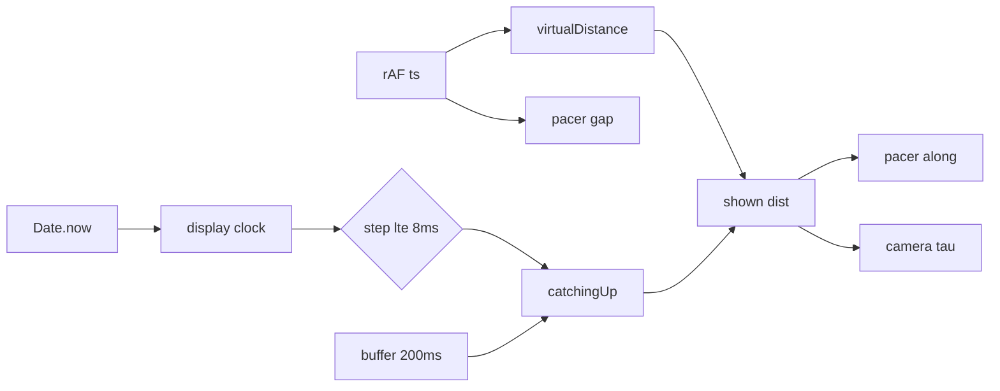

# 결과 J1 — 라이더 앞뒤 떨림 조사 + perflab 떨림 지수

| 항목 | 내용 |
|---|---|
| 지시 | `02-task-j1.md` |
| 담당 | Developer (Cursor) |
| 시각 | 2026-10-16 |
| 동작 수정 | 없음. 계측 훅·패널·재생 스크립트만 추가 |

## 결론

144 Hz 에서만 페이서가 앞뒤로 튀는 경로는 **표시 시계의 8 ms 재사용**과 **200 ms 자기 표본 버퍼**가 겹칠 때다. 60 Hz 에서는 같은 경로가 역행 0 이다.

본인과 페이서의 절대 거리가 같이 튀고, 둘의 간격은 역행하지 않는다. 화면에서 크게 보이는 쪽은 카메라 평활(τ 0.1 s)이 그 튐을 한 프레임에 따라가지 못해 생기는 상대 운동이다.

쿼리가 없는 운영 경로의 위치·페이서·동행·카메라는 바꾸지 않았다.

## 시간 근원

| 값 | 시계 | 주기 |
|---|---|---|
| 세션 `virtualDistance` | 세션 rAF 타임스탬프 | 매 프레임. 숨은 탭만 `performance.now` 를 250 ms 간격 |
| HUD `metricsUi`·페이서에 넣는 `speedKmh` | 같은 rAF 시각으로 거리·속도를 밀되 React 반영은 `METRICS_UI_MS` | 200 ms |
| `sampleLiveDistM` 캐시·`advanceSelfDisplayRenderTimeMs` | `Date.now()` 정수 ms | 호출은 매 프레임. `FRAME_REUSE_MS = 8` 이면 표시 시각은 유지 |
| 화면에 쓰는 본인 거리 | 버퍼가 없고 catch-up 이 아니면 `virtualDistance`. 아니면 버퍼 보간 | 매 프레임 |
| `selfDisplayBuffer` 표본 | 발행 순간 `tSrv` (`Date.now` + 서버 오프셋) | `PEER_MOTION_PUBLISH_INTERVAL_MS` 200 ms. `tSrv` 가 없으면 넣지 않음 |
| 페이서 `gapM` | MapView rAF `dt` | 매 프레임. `dt` 상한 0.25 s |
| 페이서 `along` | 위 본인 거리 + `gapM` | 매 프레임 |
| 동행 `step` 의 `nowMs` | MapView 가 넘기는 `Date.now()` | 매 프레임 호출 |
| 동행 표시 거리 | 동행 중이고 서버 시계가 있으면 같은 프레임 표시 시각에 잠금. 보정 스텝은 `Date.now` 간격 | 매 프레임. 8 ms 재사용을 같이 탐 |
| 동행 크랭크 `phaseRev` | `buildRenderFeatures` 의 고정 0.016 s | 위치와 무관 |
| `tickRideCameraFollow` | MapView rAF 타임스탬프. 위치 τ 0.1 s | 매 프레임 |

페이서는 `hasActivePeers()` 가 없을 때만 그린다. 동행이 있으면 페이서 경로는 꺼진다.

## 재현

앱 페이지에 `requestAnimationFrame` 을 감싼 Playwright 주행은 하지 않았다. 게스트 인증이 필요하고, 시계 분기는 지도 없이 제품 함수로 닫힌다.

`apps/web/scripts/jitter/raf-beat-replay.mjs` 가 다음을 그대로 호출한다.

- 세션과 같이 고해상 `dt` 로 `virtualDistance` 적분 (20 km/h)
- `advanceSelfDisplayRenderTimeMs(Math.floor(perf))` · `sampleSelfDisplayDistM` · `isDisplayRenderCatchingUp` · `companionDisplayDelayMs`
- 200 ms 마다 `pushSelfDisplaySample` (서버 오프셋 0, 켠 경우만)
- `stepPacerWorld` · `resolvePacerDistM`
- 카메라 τ 0.1 s 지수 평활만 별도 계산

간격 16.7 ms (60 Hz), 8.33 ms (120 Hz), 6.9 ms (144 Hz). 8 초 주행, 앞 2 초는 워밍업으로 빼고 집계. 명령 exit 0.

버퍼 없음이면 120 Hz·144 Hz 도 표시 시계가 프레임의 약 절반을 유지하지만, 본인·페이서 절대 거리 역행은 0 이다. 버퍼가 없으면 `delayed == null` 이라 catch-up 이 거리를 갈아끼우지 못한다.

버퍼 있음 (발행이 `tSrv` 를 넣는 실주행):

| 간격 | 시계 유지 프레임 | 본인·페이서 절대 역행 | 최대 역행 | 절대 속도 변동계수 | 본인 대비 간격 역행 | 카메라 대비 역행 | 카메라 대비 최대 역행 |
|---|---:|---:|---:|---:|---:|---:|---:|
| 16.7 ms | 0 / 360 | 0 | 0 | 0 | 0 | 0 | 0 |
| 8.33 ms | 245 | 146 / 720 | 0.0075 m | 0.833 | 0 | 474 / 720 | 0.0508 m |
| 6.9 ms | 435 | 245 / 870 | 0.0094 m | 1.021 | 0 | 434 / 870 | 0.0459 m |

144 Hz·버퍼 있음에서 catch-up 프레임은 435 이다. 60 Hz·버퍼 있음은 catch-up 0, 역행 0.

절대 역행이 1 cm 안쪽인 이유는 버퍼 외삽이 순간 거리와 가깝기 때문이다. 카메라가 τ 0.1 s 로 남으면서 화면 상대 거리는 약 5 cm 까지 뒤로 간다. 속도가 올라가면 이 폭은 속도와 거의 비례한다.

## 가설

| 가설 | 판정 |
|---|---|
| H1 주사율 맥놀이 | 맞다. 다만 임의의 고정 Hz 가 아니라, 프레임의 `Date.now` 간격이 8 ms 재사용 창 이하일 때만 표시 시계가 선다. 60 Hz(약 17 ms)는 매 프레임 전진한다. |
| H2 시계 혼용 | 맞다. 거리 적분·페이서 `dt`·카메라는 rAF 시각이고, 표시 시계·표본 시각·catch-up 판정은 `Date.now()` 다. catch-up 프레임만 200 ms 버퍼 거리로 바뀐다. |
| H3 카메라와의 상대 운동 | 맞다. 본인과 페이서는 같은 거리라 간격 역행은 0 이다. 화면의 툭툭은 카메라가 그 공통 튐을 늦게 따라가서 생긴다. |

동행이 있는 주행은 이번 재생에 패킷을 넣지 않았다. 동행 표시도 같은 `ensureFrameDisplayRenderTimeMs(Date.now())` 를 쓰므로 시계 정지는 같다. 패킷 간격이 만드는 추가 역행은 `?perflab=1` 의 동행 줄로 보면 된다. 페이서는 동행이 있으면 꺼진다.

## 수정안 (이번 지시에서는 적용하지 않음)

1. `ensureFrameDisplayRenderTimeMs` 의 재사용을 8 ms 창이 아니라 **같은 `Date.now()` 값**, 또는 `tickBody` 가 넘긴 **같은 rAF 세대**로 제한한다. 한 프레임 안의 `sampleLiveDistM` 과 `registry.step` 은 동기 호출이라 같은 정수 ms 를 본다. 8 ms 는 120 Hz 이상 프레임 간격보다 길다.
2. 지연 0 인 단독 주행에서, 시계가 한 틱 뒤진 것만으로 `isDisplayRenderCatchingUp` 이 참이 되어 `virtualDistance` 를 200 ms 버퍼로 바꾸지 않는다. 버퍼 전환은 동행 지연 또는 실제 모드 전환 catch-up 에만 둔다.
3. 표시 시계에 MapView rAF `now` 를 넘긴다. `sampleLiveDistM` 의 캐시 키도 `Date.now()` 가 아니라 그 시각으로 맞춘다.

## 계측

`?perflab=1` 일 때만 10 s 창에 남긴다. 쿼리가 없으면 `noteRiderJitterFrame` 이 인자 읽기·`performance.now()` 없이 반환한다.

MapView 가 3D spec 을 만든 직후 한 줄로 호출한다. 기록 거리는 본인 `distM`, 페이서 `pathDistM`(배치 좌표와 별개), 동행 `displayDistM`.

라이더마다 역행 프레임 수, 최대 역행 m, 프레임 속도 변동계수(표준편차/평균), 본인 대비 상대 거리 표준편차 m. 패널은 펼쳤을 때 한 줄. 복사 JSON 의 `jitter` 배열에 같은 값.

0.1 mm 이하 후퇴는 역행으로 세지 않는다.

## 변경 파일

- `apps/web/src/lib/debug/riderJitterProbe.ts`
- `apps/web/src/components/map/MapView.tsx`
- `apps/web/src/components/map/riderDomMarkers.ts` (`pathDistM` 필드만)
- `apps/web/src/components/perfLab/PerfLabPanel.tsx`
- `apps/web/scripts/rider-jitter.test.ts`
- `apps/web/scripts/jitter/raf-beat-replay.mjs`

## 검증

작업 디렉터리 `apps/web`. dev 서버 5070 은 띄우지 않았다. 재생용 Vite 는 미들웨어로 모듈만 읽고 `close` 했다.

| 명령 | exit |
|---|---:|
| `npx tsc -b --pretty false` | 0 |
| `npx eslint` (변경 파일) | 0. MapView 기존 react-hooks 경고 8, 오류 0 |
| `npm run test:quick` | 1. 통과 1125, 실패 3. 실패는 `functions/lib` 부재 (`harnessActive.js`, `index.js`, `index.harness.js`). 떨림 시험은 tools 묶음에 포함되어 통과 |
| `node --test scripts/rider-jitter.test.ts` | 0 (4) |
| `npm run test:pacer` | 0 (14) |
| `npm run test:peer-spacing` | 0. GATE PASS, transitions requiredFail 0, residual requiredFail 0 |
| `npm run test:rider-preserve` | 0 (42+6) |
| `npm run build` | 0 |
| `node scripts/jitter/raf-beat-replay.mjs` | 0 |

commit · push · 배포 없음.
