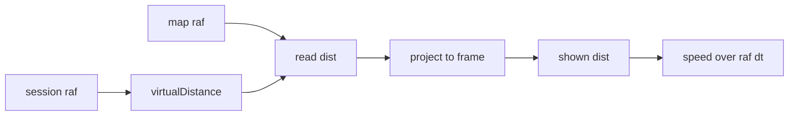

# 결과 J2 — 표시 시계와 불규칙 프레임 속도

| 항목 | 내용 |
|---|---|
| 지시 | `02-task-j2.md` (추가 절 포함) |
| 담당 | Developer (Cursor) |
| 시각 | 2026-10-16 |
| 브랜치 | `fix/rider-jitter` @ `7cdc3b9` |
| 커밋 | 없음 |

## 결론

중단된 작업트리의 표시 시계 수정을 유지했다. 그 위에, 지도 rAF 가 세션 적분보다 먼저 거리를 읽을 때 이번 프레임 시각까지 거리를 계산해 보여 주게 했다.

20 km/h 일정 속도에서 20/30 ms 와 16.7/33.3 ms 를 섞으면, 고치기 전 본인·페이서 speedCv 는 0.2899 / 0.4880 이고 역행은 0 이다. 고친 뒤 speedCv 는 0.0000, 역행은 0 이다. 동행 패킷을 같은 시계로 재생하면 고치기 전 0.2899 / 0.4880, 고친 뒤 0.0000 이다.

8 ms 재사용 창은 이 간격에서 걸리지 않는다. 같은 루프에서 적분과 표시를 같이 하면 불규칙 간격에서도 speedCv 0, 시계 유지 0, catch-up 0 이다. Chief 실측(역행 0, speedCv 0.22–0.59)과 맞는 재현은 프레임 위상이다. 화면 이동량은 이전 rAF 간격이고, perflab 분모는 이번 rAF 간격이다.

## 이어받은 수정

작업트리에 있던 미커밋 차이를 유지했다.

1. `MapView` `tickBody` 가 `epochMs = performance.timeOrigin + now` 를 한 번 계산해 `sampleLiveLngLat`, `sampleLiveDistM`, 동행 `step` 의 `nowMs` 에 넘긴다. 틱 밖은 `Date.now()`.
2. `ensureFrameDisplayRenderTimeMs` 는 8 ms 창 대신 같은 epoch 값만 재사용한다.
3. 지연 0 이고 모드 전환이 아니면, 시계가 한 틱 뒤진 것만으로 `isDisplayRenderCatchingUp` 이 참이 되지 않는다. 동행을 끄는 모드 전환 catch-up 은 유지된다.
4. 숨은 탭 250 ms 걸음은 `frameEpochMs` 를 넘기지 않는다. 그 경로는 그대로다.

## 이번 추가

`sampleLiveDistM` 이 프레임 epoch 를 받고 주행 중이면 `projectRideDistToFramePerfMs` 로 이번 프레임 perf 까지의 거리를 읽는다. `virtualDistance` 는 세션 rAF 만 더한다. 동행 지연이 있거나 모드 전환 catch-up 이면 기존처럼 버퍼 보간이 이 값을 덮는다.

카메라 τ, fanout, 버퍼 길이, 지연 정책, 렌더·리그는 바꾸지 않았다.

## 재생

속도 20 km/h. 8 초, 앞 2 초는 집계에서 뺀다. speedCv 는 perflab 과 같이 `(거리 차) / (그 프레임 rAF 간격)` 의 표준편차/평균. 0.1 mm 이하 후퇴는 역행이 아니다. 섞임은 mulberry32 시드 `20261016`(20/30), `20261017`(1000/60 과 1000/30).

같은 루프(시계만, 버퍼 있음):

| 시나리오 | 시계 유지 | catch-up | 본인·페이서 역행 | speedCv |
|---|---:|---:|---:|---:|
| 20/30 | 0 | 0 | 0 | 0.0000 |
| 16.7/33.3 | 0 | 0 | 0 | 0.0000 |

위상 (지도가 적분 전에 읽음 → 프레임 시각으로 읽기). 동행은 패킷을 200 ms 마다 넣고, 고치기 전은 step 시각을 한 프레임 늦은 간격으로, 고친 뒤는 프레임 epoch 로 민다.

| 시나리오 | 본인·페이서 speedCv 전 | 역행 전 | speedCv 후 | 역행 후 | 동행 speedCv 전 | 동행 speedCv 후 | 동행 역행 후 |
|---|---:|---:|---:|---:|---:|---:|---:|
| 20/30 | 0.2899 | 0 | 0.0000 | 0 | 0.2899 | 0.0000 | 0 |
| 16.7/33.3 | 0.4880 | 0 | 0.0000 | 0 | 0.4880 | 0.0000 | 0 |

일정 간격은 J1 표가 수정 전이다. 버퍼가 있을 때 144 Hz 절대 역행 245/870, speedCv 1.021. 이번 재생(60/120/144/165 Hz × 버퍼 있음·없음, 8조합)은 절대 역행 0, 카메라 대비 역행 0, 시계 유지 0, catch-up 0, speedCv 0.0000.

간격이 16.7 ms 로 일정하면 적분보다 먼저 읽어도 speedCv 는 0.0000 이다. 60 Hz 근처에서 툭툭이 안 보이던 이유와 같다.

## 카메라

τ 0.1 s 는 그대로다. 불규칙 간격에서는 이산 추종의 정상 지연이 프레임 간격에 따라 달라져, 본인·페이서가 일정 속도여도 카메라 대비 거리는 프레임마다 조금 줄어들 수 있다.

| 시나리오 | 보정 전 역행 프레임 | 보정 전 최대 | 보정 후 역행 프레임 | 보정 후 최대 |
|---|---:|---:|---:|---:|
| 20/30 | 119 / 241 | 0.0536 m | 121 / 241 | 0.0056 m |
| 16.7/33.3 | 116 / 240 | 0.0887 m | 123 / 240 | 0.0096 m |

절대 역행은 0 이다. 보정 후 카메라 대비 최대 후퇴는 1 cm 미만이다. τ 를 바꾸지 않았으므로 이 잔여는 Supervisor 판정이다.

## 변경 파일

- `apps/web/src/lib/peerMotion/commonDisplayClock.ts`
- `apps/web/src/components/map/MapView.tsx`
- `apps/web/src/hooks/useVirtualRideSession.ts`
- `apps/web/src/lib/ride/frameDistProject.ts`
- `apps/web/scripts/jitter/raf-beat-replay.mjs`
- `apps/web/scripts/jitter/raf-beat-replay.test.mjs`
- `apps/web/scripts/test-quick.mjs` (`jitter` 묶음)

## 검증

작업 디렉터리 `apps/web`. dev 서버와 브라우저는 띄우지 않았다. 실기기 perflab 은 다시 재지 않았다.

| 명령 | exit |
|---|---:|
| `npx tsc -b --pretty false` | 0 |
| `npx eslint` (변경 ts/tsx·jitter 스크립트·test-quick) | 0. MapView 기존 react-hooks 경고 8, 오류 0 |
| `node --test scripts/jitter/raf-beat-replay.test.mjs` | 0 (8) |
| `node scripts/jitter/raf-beat-replay.mjs` | 0 |
| `npm run test:quick` | 1. 통과 1133, 실패 3. 실패는 `functions/lib` 부재 (`harnessActive.js`, `index.js`, `index.harness.js`). ride 묶음 752 통과 |
| `npm run test:peer-spacing` | 0. GATE PASS, transitions requiredFail 0, residual requiredFail 0 |
| `npm run test:pacer` | 0 (14) |
| `npm run test:rider-preserve` | 0 (42+6) |
| `npm run build` | 0 |

commit · push · 배포 없음.
