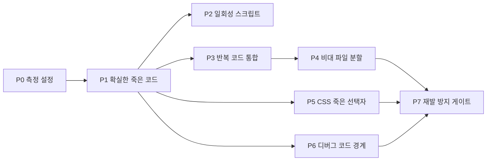

# 코드 정련 계획 — 반복·댕글링·비대 코드 정리

2026-10-22 · plan · Supervisor(Claude) · **Chief 승인 대기**

## 0. 목적과 원칙

수정·삭제·추가가 쌓이며 생긴 **반복 코드, 아무도 부르지 않는 코드(댕글링), 한 파일에 몰린 비대 코드**를 정리한다.

1. **동작은 바꾸지 않는다.** 화면·주행·저장 결과가 정리 전과 같아야 한다. 기능 수정이 섞이면 그 지시는 반려한다.
2. **작게 자르고, 한 번에 한 묶음.** 지시 1건 = 도메인 1개 또는 파일 1~3개. 지시마다 커밋 1개라 되돌리기 쉽다.
3. **측정으로 시작해서 측정으로 끝낸다.** 아래 기준선 숫자가 줄었는지로 판정한다. 「깔끔해 보인다」는 판정이 아니다.
4. **규칙을 넓혀서 통과시키지 않는다.** dep-layers·lint·계약 시험·baseline 은 고치지 말고 코드를 고친다.
5. **삭제는 증거로.** 「안 쓰인다」는 도구 결과 + `rg` 로 문자열 참조(동적 import·주소 스위치·npm script·functions 미러)까지 확인한 뒤에만 지운다. git 이력에 남으므로 되돌릴 수 있다.

## 1. 기준선 (2026-10-22, main2 `a123fb67`)

| 항목 | 값 | 도구 |
|---|---|---|
| web 소스 | `src` 비시험 TS/TSX 382개 · 약 73,500줄 · CSS 13,292줄 | wc |
| **비대 파일** | `App.tsx` 3,741 · `MapView.tsx` 3,589 · `mapPopupElements.ts` 1,176 · `UserInfoSheet.tsx` 917 · `MapView.css` 1,829 · `MapHud.css` 1,712 | wc |
| **반복 코드** | 33쌍 · 549줄 (0.75%) — 낮은 편, 대신 덩어리가 크다 | jscpd 4.0.5 (8줄·70토큰 이상) |
| **안 쓰이는 파일** | 50개 (src 6 · scripts 44) | knip 최신 |
| **안 쓰이는 export** | 값 464 · 타입 90 | knip |
| **같은 것 두 이름** | 10건 (예: `countCourseActivityLiveInBatch` = `countRouteActivityLiveInBatch`) | knip |
| **확인된 결함** | `riderRig.ts` 의 `SADDLE`·`PELVIS` 가 없는 export 를 가리켜 **항상 undefined** (빌드 경고) | vite build |
| 디버그 코드 | `lib/debug` 24파일 · `console.log/debug` 21곳 · DEV 분기 49파일 | rg |
| functions | 일회성 backfill·CLI 39파일 | ls |

원자료: [evidence/00-knip-baseline.json](evidence/00-knip-baseline.json) · [evidence/00-jscpd-baseline.json](evidence/00-jscpd-baseline.json)

> knip 수치에는 **오탐이 섞여 있다.** npm script·명령줄로만 실행되는 `scripts/`, `.mjs` 옆의 `.d.mts`, 시험에서만 쓰는 export 가 「안 쓰임」으로 잡힌다. P0 에서 설정을 잡아 진짜 숫자로 다시 잰다.

## 2. 단계

| 단계 | 내용 | 실행 | 위험 | 완료 조건 |
|---|---|---|---|---|
| **P0** 측정 설정 | `apps/web/knip.json` 작성(진입점 = `main.tsx`·시험·`package.json` script·`dev-tools.json` 등록 스크립트). 오탐을 걷어낸 **진짜 기준선** 확정 | Claude 직접 | 없음(설정만) | 기준선 v2 표, 오탐 유형 목록 |
| **P1** 확실한 죽은 코드 | ① `SADDLE`·`PELVIS` 결함 정리 ② src 안 쓰이는 파일(`openMeteoWeather.ts` — 08-27 날씨 표시 삭제 잔재, `riderBody.mjs` 등) ③ 안 쓰이는 export: 내부에서도 안 쓰면 삭제, 내부만 쓰면 `export` 만 뗀다 ④ 두 이름 10건을 하나로(Ontology 기준 — `course` 쪽을 지운다). **도메인 단위로 5~6개 지시**(peerMotion · ride · route · map · riderPrototype · 나머지) | opencode GLM-5.3-Flash | 낮음 | 도메인별 knip 0 · 빌드 경고 0 |
| **P2** 일회성 스크립트 | `scripts/` 미사용 44개를 `dev-tools.json` 의 `class: temporary` 와 대조. 끝난 실험(peer-sync `s2~s41-summarize`, rider14 stage 등)은 삭제, 계속 쓰는 하네스는 등록부에 올린다 | 분류 Claude · 삭제 opencode | 낮음 | 미등록·미사용 스크립트 0 |
| **P3** 반복 코드 통합 | 큰 덩어리 우선 6건: 구독 허브 2개(`rtdbMotionSubscriptionHub`↔`livePublicationRidesSubscriptionHub` 99줄) · publish flight 2개 · Lab 패널 2개(TSX+CSS) · 라이브 오버레이 훅 2개 · Mapbox 요청 2개(`distanceAutoRouteApi`↔`mapboxDirections`) · resume slot 2개. 공통 함수로 뽑고 **양쪽 시험을 먼저 고정** | Cursor | 중간 | jscpd 549→250줄 이하, 단위 시험 수 유지 |
| **P4** 비대 파일 분할 | `App.tsx` → 기능별 훅/섹션, `MapView.tsx` → 레이어·제스처·팝업 연결, `mapPopupElements.ts` → 탭별 빌더. **파일 1개 = 지시 2~4건**, 옮기기만 하고 로직은 안 바꾼다 | Cursor | **높음** | 각 파일 1,200줄 이하 · e2e·selector19 PASS · 3폭 캡처 동일 |
| **P5** CSS 죽은 선택자 | TS/TSX 어디에도 없는 클래스명 목록(동적 조합 `--${x}` 는 수동 확인) → 삭제 | 목록 Claude 스크립트 · 삭제 opencode | 중간(보이는 것) | 3폭(667·740·844)×주요 상태 캡처 픽셀 비교 동일 |
| **P6** 디버그 코드 경계 | 운영 번들(`index-*.js`)에 들어가는 디버그 모듈·로그를 잰다. DEV·주소 스위치 밖으로 새는 것만 분리/삭제. `dev-tools.json` 등록 도구는 유지 | Claude 측정 · opencode 수정 | 낮음 | 운영 번들 크기 감소량 기록, 디버그 문자열 grep 0 |
| **P7** 재발 방지 | knip 숫자 래칫(늘면 pre-push 실패) · jscpd 상한 · 파일 줄 수 상한(신규 1,200줄 초과 금지). `verify-gates-alive.mjs` 에 깨뜨리기 사례 추가 | Claude 직접 | 낮음 | 게이트를 일부러 깨뜨려 실패 확인 |

functions 의 backfill·CLI 39파일은 **이번 범위 밖**이다. 운영 데이터를 고치는 도구라 남길지 말지는 별도 판단(§5-3).

## 3. 역할과 순서

- **Claude(수퍼바이저):** P0·P7 직접, 각 지시서 작성, 결과 1차 검증(타입·lint·단위·selector·build·knip/jscpd 재측정·캡처). Cursor·opencode 의 「PASS」 보고는 믿지 않고 다시 돌린다.
- **opencode GLM-5.3-Flash:** 판단이 거의 없는 삭제·`export` 떼기·이름 통일·파일 삭제(P1·P2·P5·P6).
- **Cursor:** 구조 판단이 필요한 통합·분할(P3·P4).
- 순서: P0 → P1(도메인 순차) → P2·P5·P6 은 서로 독립이라 교대로 → P3 → P4 → P7. 예상 지시 수 약 20~25건.

## 4. 매 지시의 검증 (Claude 가 직접)

| 검사 | 명령(폴더) |
|---|---|
| 타입 | `npx tsc -b --noEmit` (`apps/web`) — `-p .` 는 빈 검사라 쓰지 않는다 |
| lint | `npm run lint` (`apps/web`) — 오류 0, 경고 늘지 않음 |
| 단위 | `npm run test:quick` (`apps/web`) — 1,341건 이상, 실패 0 |
| 의존 방향 | `node scripts/check-dep-direction.mjs --check` |
| 진입 셀렉터 | selector 계약 19단계 |
| 빌드 | `npm run build` (루트) — 경고 늘지 않음, 번들 크기 기록 |
| 정리 지표 | knip·jscpd 재측정, 해당 단계 숫자 감소 확인 |
| 화면(P4·P5) | 800×360 등 3폭 캡처를 정리 전과 나란히 비교 |

**반려 조건:** 동작 변경, 시험 삭제·완화, baseline/규칙 파일 수정, 범위 밖 파일 수정, 진행 중인 다른 묶음 파일 변경.

## 5. Chief 결정이 필요한 것

1. **P4(App·MapView·mapPopupElements 분할) 시점.** 지금 [800×360 UI 묶음](../20261020-ui-800x360/README.md)이 `MapView.tsx`·`mapPopupElements.ts` 를 매일 고치고 있다. 동시에 하면 서로 덮어쓴다.
   - (권장) UI 묶음이 일단락될 때까지 P4 만 미루고 P0~P3·P5~P6 을 먼저 한다.
   - 또는 UI 작업을 잠시 멈추고 P4 를 먼저.
2. **끝난 실험 스크립트:** (권장) 삭제(git 이력에 남음) / 또는 `archive/` 폴더로 이동.
3. **functions backfill·CLI 39파일:** 이번엔 목록만 만들고 판단은 나중에(권장) / 같이 정리.
4. **배포:** 동작 불변 정리라 (권장) 단계(P1·P3·P4…)가 끝날 때마다 묶어서 배포 / 또는 전체 끝나고 한 번.

## 6. 다음 행동

Chief 승인 → Claude 가 P0(knip 설정·기준선 v2) 수행 → P1 첫 지시서(`02-task-01.md`, riderRig 결함 + peerMotion 도메인)를 opencode 에 배분.
