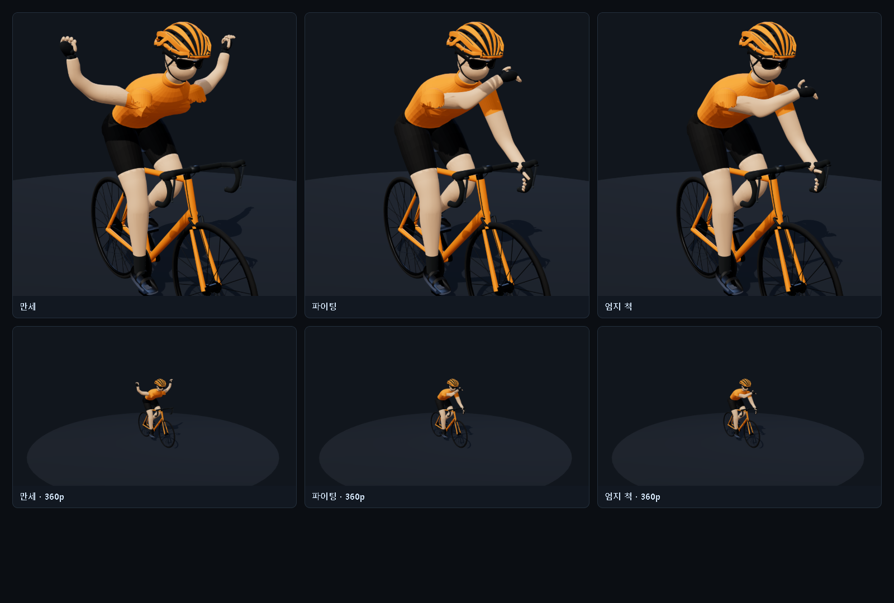

# rider15 포즈 시안 — 만세 · 파이팅 · 엄지 척

- 작성: 2026-11-04 · OpenCode
- 상태: **시안(APPROX)** — 제품 GLB·코드 변경 없음. 승인 전 참고 자료
- 질문: "만세 자세, 파이팅 자세, 엄지 척 자세가 가능할까? 가능하면 시안을 만들어 달라"
- 시안 렌더: `pose-preview/` (실제 메시 변형으로 근사)



---

## 1. 결론

| 포즈 | 가능 여부 | 새로 필요한 것 | 화면(360p)에서 읽히나 |
|---|---|---|---|
| **만세** | **가능** | 없음(계획한 8본 그대로) | ✅ 실루엣 폭 +40% |
| **파이팅** | **가능** | 손가락 **주먹 morph 1개** | ✅ 팔 높이 +25% |
| **엄지 척** | **가능** | 손가락 morph + **엄지 본 1개/손** | ❌ (라이더 115 px에서 엄지는 ≈5 px) |

핵심: 세 동작 모두 **본을 더 만들 필요는 없고**, 손가락만 **morph target(블렌드 셰이프)** 으로 처리하면
드로우콜 증가 0, 삼각형 증가 ≈ 0 으로 끝난다. 단 **엄지 척은 확대 카메라(포토 모드·결과 화면)에서만 의미**가 있다.

---

## 2. 왜 지금은 안 되는가 (구조 확인)

- 제품 rider14: 노드 14 · **skins 0** · 메시 1장(`static__Palette` 16,314 tri)에
  머리·헬멧·저지·**양팔·손**·자전거 프레임이 함께 들어 있다.
- 상체에 존재하는 유일한 변형은 `_sway` **정점 스칼라 1개**로 전신을 피벗 회전시키는 셰이더뿐
  (`preservedRiderRig.ts:44-49`) → 어깨·팔꿈치 관절 자체가 없다.
- 따라서 **메시 재저작 없이는 세 포즈 중 어느 것도 불가능**하다. 이 시안은 그 재저작 이후를 근사한 것이다.

## 3. 시안을 만든 방법 (정직한 한계)

제품 후보 `20260921-041426-cd81398e/rider.glb`(부위 이름이 남아 있는 원본)를 그대로 두고,
- 어깨(0.1286, 1.1691, ±0.1804) → 후드(0.54736, 0.83558, ±0.189) 축에서 **거리 가중 LBS**를 계산하고
- 포즈별 **손 목표점 + 팔꿈치 pole** 로 2-bone IK 를 풀어 상완·전완 회전을 만들고
- 손가락은 rest space 에서 접고(주먹) 엄지는 세운 뒤, 손 메시는 전완 본에 **강체**로 붙였다.

한계(시안이지 리깅 결과물이 아니다):
- 어깨 겨드랑이에 주름이 생긴다 — 실제로는 Blender 정점 가중치 + corrective shape 로 풀어야 하는 지점이다.
- 손목 관절이 없어 손의 방향은 전완을 따른다.
- 관통 검사·팔레트 재칠·LOD·성능은 검증하지 않았다.

재현: `node apps/web/scripts/rider-pose/capture-poses.mjs` (산출 `document/ops/20261104-rider-v2-upper-body/pose-preview/`)

---

## 4. 포즈별 요구 사항

### 4.1 만세 — 추가 비용 0

| 항목 | 값 |
|---|---|
| 관절 | 어깨 외전 120~140°, 팔꿈치 신전 |
| 새 본 | **없음** (pelvis·spine·chest·neck·shoulder L/R·elbow L/R 8본) |
| 새 morph | 없음 |
| 실패 지점 | **겨드랑이 가중치** — 여기가 유일한 난제. 프리뷰에서 겨드랑이 4뷰 필수 |
| 드로우콜 | 0 증가 |

### 4.2 파이팅 — morph 1개

| 항목 | 값 |
|---|---|
| 관절 | 어깨 굴곡 ~90°, 팔꿈치 굴곡 110~120° |
| 새 본 | 없음 |
| 새 morph | **`fist` 1개** (양손 손가락을 접는 delta) — 정점 수 증가 없음, 자산 +≈8 KB |
| 왜 본이 아니라 morph 인가 | 손가락 4관절 × 8손가락 = 32본은 비용·리깅 공수가 모두 과하다. 주먹은 **한 상태**뿐이므로 morph 가 맞다 |
| 드로우콜 | 0 증가 |

### 4.3 엄지 척 — morph 1개 + 엄지 본 1개/손

| 항목 | 값 |
|---|---|
| 관절 | 손목 회내 + 엄지 신전 |
| 새 본 | **thumb L/R 2개** (기존 계획의 "미튼+엄지 1" 유지) |
| 새 morph | `fist` 재사용 (검지~소지 접기) |
| 삼각형 | 엄지를 분리·유지하므로 **+≈120 tri** (계획표의 −490 tri 안에 이미 포함) |
| 드로우콜 | 0 증가(같은 스킨 메시) |
| **가독성** | 360p 라이더 115 px → 엄지 ≈ **5 px**. 주행 화면에서는 **보이지 않는다** |

> ⚠ **설계 충돌 1건**: README 5.1 의 "손가락 8 + 손가락 구멍 16 → 미튼+엄지 1" 은
> 엄지를 **남기는** 계획이므로 엄지 척과 충돌하지 않는다. 만약 비용을 더 줄이려 엄지까지 없애면
> 이 포즈는 영구히 불가능해진다. **엄지는 남긴다.**

---

## 5. 앱 쪽에서 새로 필요한 것 (포즈 자체보다 이쪽이 본체)

1. **손 고정 해제 모드**
   현재 손은 후드에 IK 로 고정된다. 포즈는 손을 떼므로 `anchor: "hood" | "free"` 상태와
   **0.35 s 크로스페이드**(hood→pose, pose→hood)가 필요하다. IK 수식은 그대로 쓴다(`riderGlbPedalPose`).
2. **포즈 프리셋 = 손 목표점 + 팔꿈치 pole + morph 가중치** 데이터. 본 회전을 하드코딩하지 않는다.
3. **트리거 규칙**(제안)
   - 피니시(완주) 3초: `만세` 또는 `파이팅` 1회
   - 결과 화면/포토 모드: `엄지 척`
   - **주행 중 금지** — 핸들에서 손을 떼는 순간 물리·안전 서사가 깨진다
4. **셰이더 주의**: `_sway` 주입이 `#include <begin_vertex>` 직후라 morph·skin 보다 **먼저** 돈다.
   상체 메시에 morph 를 넣으면 주입 지점을 `<morphtarget_vertex>`·`<skinning_vertex>` **뒤**로 옮겨야 한다.

---

## 6. 비용 요약 (계획 대비 증분)

| 항목 | 증분 |
|---|---|
| 삼각형 | +≈120 (엄지 유지) / 목표 24,000 안 |
| 드로우콜 | 0 (11 유지) |
| 본 | +2 (thumb L/R) → 총 10 |
| morph target | 1 (`fist`) — 자산 +≈8 KB |
| 자산 | ≈ +8 KB (목표 ≤210 KB 안) |
| 앱 | anchor 전환 + 프리셋 3개 + morph 가중치 ≈ 250~400 LOC |
| 모델 | 손가락을 morph 로 접히게 만드는 것 = Blender shape key 1개 (0.5일) |

---

## 7. 판정 요청

| # | 질문 | 권장 |
|---|---|---|
| Q6 | 세 포즈를 v2 범위에 포함하는가 | **만세·파이팅 포함**, 엄지 척은 "포토 모드 전용" |
| Q7 | 주먹을 morph 로 처리 | **morph** (본 32개 대신) |
| Q8 | 포즈 트리거 | 피니시 3초 + 결과 화면 수동 |

---

## 8. 산출물

```
pose-preview/sheet.png                  3포즈 + 360p 축척 대조 시트
pose-preview/pose-0-ride.png            기준(주행)
pose-preview/pose-1-manse.png           만세
pose-preview/pose-2-fight.png           파이팅
pose-preview/pose-3-thumb.png           엄지 척
pose-preview/pose-2-fight-closeup.png   파이팅 접사
pose-preview/pose-3-thumb-closeup.png   엄지 척 접사
pose-preview/phone-*.png                360p(라이더 ≈115 px) 실측 대조
apps/web/scripts/rider-pose/pose-lab.html       포즈 랩(three.js, 읽기 전용)
apps/web/scripts/rider-pose/capture-poses.mjs   캡처 러너
apps/web/scripts/rider-pose/compose-sheet.html  시트 합성
```
